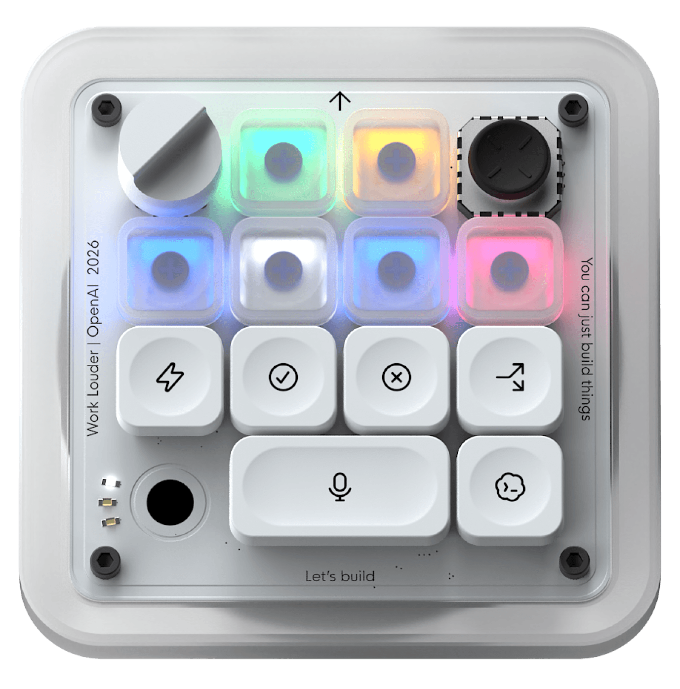

# Codex Micro Keyboard

[](https://github.com/krisxia0506/codex-micro/actions/workflows/ci.yml)
[](LICENSE)
[](docs/research/codex-micro.md)

一款以 Codex Micro 为设计参考、支持语音输入的开源键盘项目。

目标是把快捷键、旋钮和语音输入放在手边：按住说话，松开结束，检查识别文字，再输入到桌面应用。

**项目处于调研与设计阶段。已提供网页 3D 模型工作台和可导出的 STL 概念试样；尚无可用硬件、固件或桌面程序，也没有可安装的发布版本。**

## 项目方向

- 紧凑的可编程键盘布局，支持常用快捷操作。
- 专用语音输入键，控制录音的开始与结束。
- 识别结果可检查、编辑、取消和发送。
- 探索旋钮、RGB 灯和桌面配置体验。
- 随开发进度公开硬件设计、物料清单、固件及组装说明。

控制协议原型可先使用电脑麦克风，复用官方桌面应用的听写能力。整机目标是内置麦克风、电池，并支持 USB 有线与蓝牙无线两种连接；主控、充电管理和音频传输仍待选型，尚未完成双模硬件验证。路线图中的功能均为计划。

## 键盘候选方案

项目保留多种键盘与主控方案，尚未确定统一硬件平台。

| 方案 | 设计方向 | 当前状态 |
| --- | --- | --- |
| [void9 + Pro Micro（ATmega32U4）](docs/hardware/void9-pro-micro.md#3-pro-microusb-厂商-hid-协议移植) | 参考同主控 LUFA 固件，移植 USB 厂商 HID 兼容协议 | 已有开源参考；本项目未移植或实测 |
| [ESP32 / BLE 候选路线](docs/hardware/void9-pro-micro.md#4-esp32ble-厂商-hid-协议路线) | 参考 Core2 固件，将 BLE 协议与物理九键适配 | 具体开发板待选；不能推广到整个 ESP32 系列 |
| [快捷键降级](docs/hardware/void9-pro-micro.md#5-快捷键降级只承诺实际可映射的能力) | 协议兼容失败时，逐项核对目标系统的快捷键 | Fast、Fork、Mic 等不承诺与原版等价 |

各方案独立评估。采用 void9 方案不意味着后续键盘都必须使用 Pro Micro 或 QMK。

九键目标布局为 **Agent 1 / Agent 2 / Agent 3；Fast / Approve / Decline；Fork / Mic / Send**：保留原版六种默认命令动作，仅缩减 Agent 槽位数量。能力边界与配图见[完整方案](docs/hardware/void9-pro-micro.md)。

## 内置麦克风候选方案

[LE Audio：仅麦克风输入与 BLE 键盘共存调研](docs/hardware/le-audio-microphone.md)整理了结合 voxu 的无线音频候选路线、Mac 兼容性风险、主控要求和原型验收步骤。

**2026-11-01 结论：当前调研与实测没有找到能同时满足「Mac 蓝牙直连、免驱、只出现麦克风输入设备」的可行方案，暂不承诺这项能力。** XIAO nRF52840 Sense Plus 原型已完成安全配对与音频服务读取，但 Mac 未启动音频流或创建系统输入设备；这不等于证明所有 Mac 永久不支持 LE Audio。详见[实验结果与路线决策](docs/hardware/le-audio-microphone.md#2026-11-01-决策记录)。

接受头戴式耳机输入/输出双端点时，可继续评估现有 ESP32-WROOM-32 的 HFP / HID 路线；USB 有线或无线 USB 接收器可另行设计仅输入设备，但接收器方案不属于蓝牙直连。完整键盘、USB 双模及电池均未验收，不因本次调研锁定整机主控。

## 产品调研

[阅读 Codex Micro 键盘产品调研](docs/research/codex-micro.md)，了解参考产品的控件、任务灯和语音输入流程。



*上图为 Work Louder 官方参考产品，并非本项目已制作的样机。图片来源与权利说明见 [NOTICE](NOTICE)。*

## 3D 模型工作台

准备先接按键：阅读 [v0.22 按键电路、物料清单与焊接教程](docs/hardware/key-matrix.md)。按现有 XIAO Sense Plus 与 13 轴布局设计，附串口测试程序；先接一键验证，再扩展到完整矩阵。电气与装配尚待实物验收，网页示意线不能直接作为接线图。

支持旋转、爆炸拆解、逐件显隐和 STL 下载。当前按 XIAO nRF52840 Sense Plus、热插拔底座和软线飞线结构展示，不使用整块键盘 PCB。网页和打印文件共用几何源。运行方式和打印边界见[模型工作台说明](docs/model-workbench.md)。

```bash
npm ci
npm run dev
```

## 开始了解项目

```bash
git clone https://github.com/krisxia0506/codex-micro.git
cd codex-micro
```

从产品调研和路线图开始阅读。网页构建见模型工作台说明；按键原型的串口诊断程序与烧录步骤见[焊接教程](docs/hardware/key-matrix.md)，完整键盘与音频固件尚未实现。

## 路线图

- [x] 完成参考键盘的产品形态与语音输入调研。
- [ ] 确定首版布局、连接方式、麦克风方案和目标系统。
- [ ] 验证按键触发录音、语音识别和文字输入的最小闭环。
- [ ] 实现键盘固件及必要的桌面配套工具。
- [ ] 完成样机、物料清单和组装文档。
- [ ] 发布经过验证的版本与兼容性说明。

## 参与贡献

欢迎通过 [Issues](https://github.com/krisxia0506/codex-micro/issues) 提交需求、硬件选型建议和问题，通过 Pull Request 改进文档及后续实现。

- [贡献指南](CONTRIBUTING.md)
- [行为准则](CODE_OF_CONDUCT.md)
- [安全问题报告](SECURITY.md)

## 仓库质量检查

本地使用 Python 3.12 或更高版本运行：

```bash
python3 scripts/check_repository.py
git diff --check
```

CI 在 Pull Request 和 `main` 更新时检查已跟踪 Markdown 的内联链接目标文件、素材 SHA-256 清单和补丁空白错误。不请求外部网站，不检查标题锚点、引用式链接或 HTML 链接。CI 也执行网页构建和 STL 几何测试；不包含硬件、固件或桌面程序的功能验证。

GitHub Actions 依赖固定到提交 SHA，由 Dependabot 每周检查更新。仓库维护设置见[维护说明](docs/maintaining.md)。

## 许可证与项目关系

本项目原创内容采用 [MIT License](LICENSE)。第三方参考图片、名称与商标不包含在 MIT 授权中，详见 [NOTICE](NOTICE)。未来引入的第三方依赖或硬件设计将分别注明适用许可。

这是独立社区项目，与 OpenAI、Work Louder 没有官方隶属或合作关系。Codex Micro 名称用于说明设计参考，相关名称与商标归各自权利人所有。
