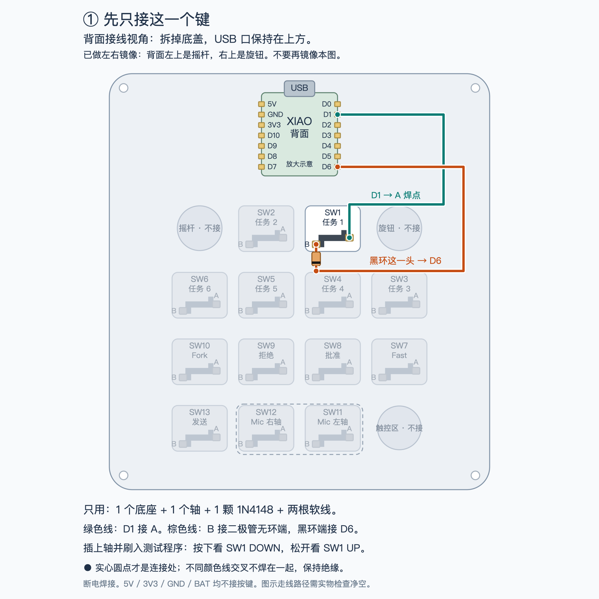
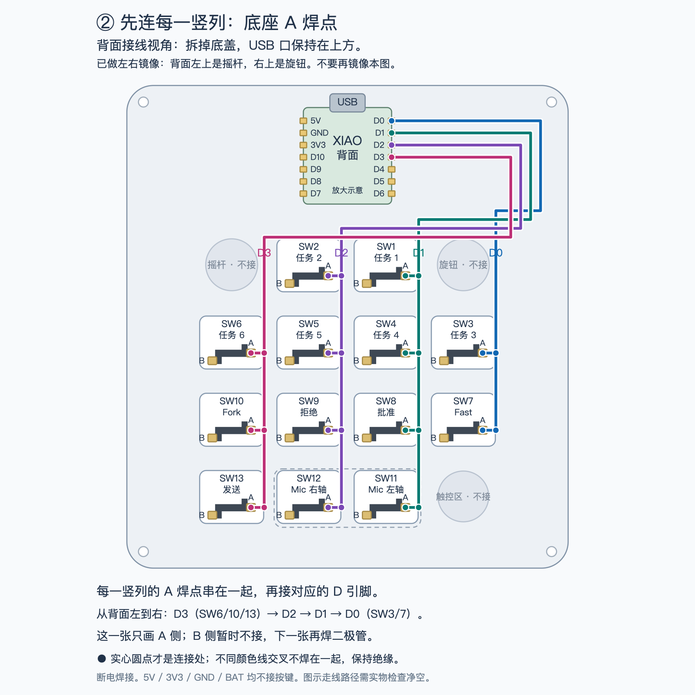
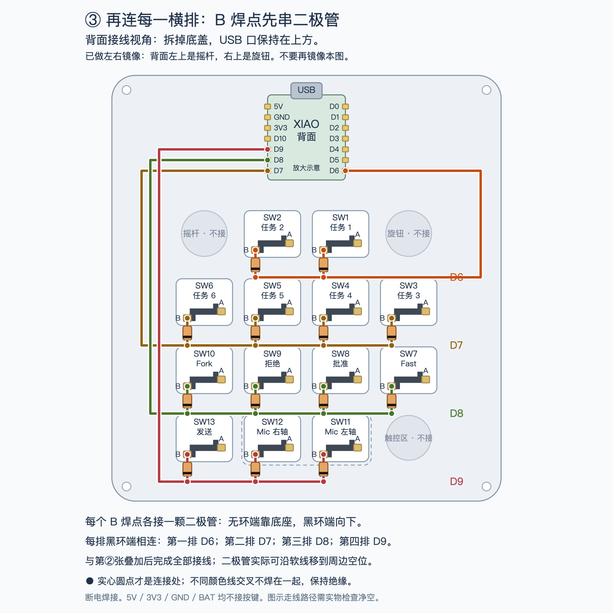
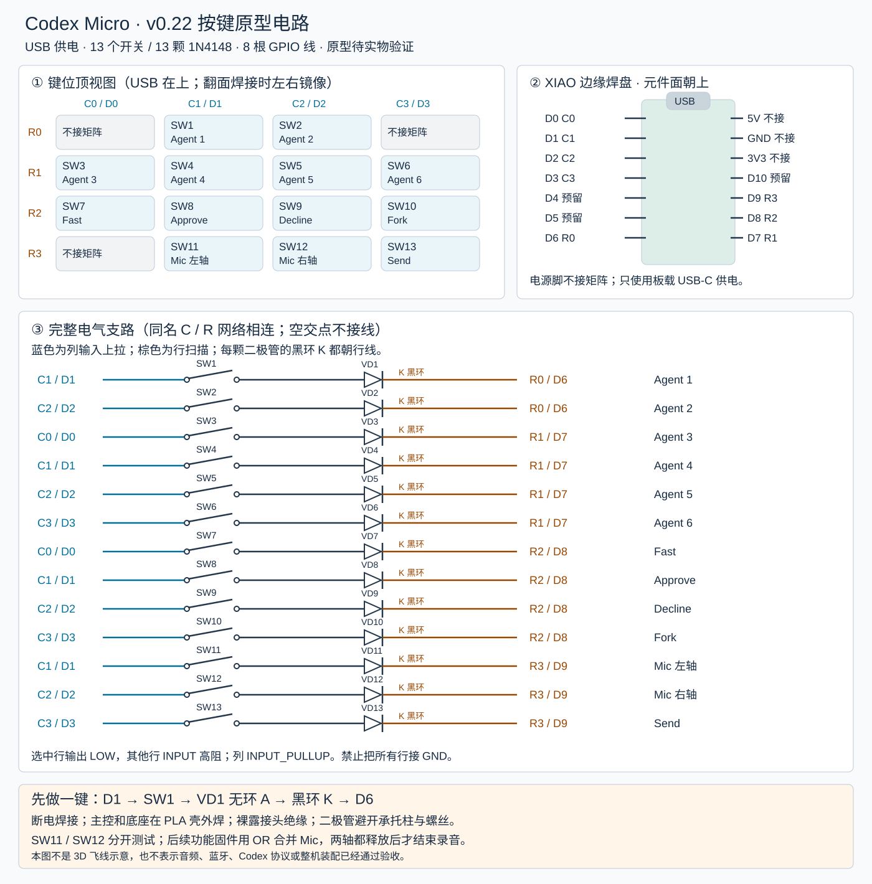

# v0.22 按键飞线电路与焊接教程

设计日期：2026-11-08。适用：**XIAO nRF52840 Sense Plus + v0.22 外壳 + 13 个深海 MINI 轴 + CPG135001S30 底座**。这是第一阶段的 USB 供电按键原型，目标是在串口逐键看到按下和松开；尚未完成实物焊接、装配或固件烧录验证。它不是旧版 void9 九键接线。

先做一键，再接其余十二键。首轮不接电池、灯、旋钮、摇杆、触控或音频线路，也不需要单独购买麦克风。板载麦克风的存在不代表 USB/蓝牙音频已经实现。

## 先看这三张：按键盘形状接线

**拆掉底盖，从背面看，USB 口仍然朝上。** 下面已经左右镜像：摇杆在左上、旋钮在右上，SW1 在上排靠右；不要按正面布局再翻一次。主控画的是背面，两侧引脚也已经镜像。元件和焊点为便于阅读而放大，线路表示电气连接，不表示可直接塞入外壳的精确长度和走线路径。

图中的 **A / B 是我们给底座两个焊片起的名字，不是底座原有丝印**。按本图的底座朝向：右上侧焊片标 A，左下侧焊片标 B。A 接竖列线；B 先串二极管，再接横排行线。底座本身没有正负极，二极管才有方向。

### 第一步：只接 SW1

绿色线把 **D1 接到底座 A**；底座 B 接二极管的无环端，**黑环端通过棕色线接 D6**。其他键先不接。断电焊好、检查后，再刷测试程序验证一次按下和松开。



[放大矢量图：单键接线](assets/wiring-single.svg)

### 第二步：把每竖列的 A 焊点连起来

同色线是一根网络，可以分段焊接串起来，不需要每个轴单独拉一根线到主控。背面从左到右四列分别接 **D3、D2、D1、D0**。已经接好的 SW1 绿色线属于 D1 这一列，继续扩展即可，不另做一套。



[放大矢量图：四列接线](assets/wiring-columns.svg)

### 第三步：每个 B 焊点串二极管，再连接横排

每个底座 B 各接一颗二极管，无环端靠底座，**图中所有黑环朝下**。每排的黑环端连起来：从上到下分别接 **D6、D7、D8、D9**。第二张和第三张是同一个键盘的两部分接线，都做完才是完整矩阵。



[放大矢量图：二极管与四行接线](assets/wiring-rows.svg)

**实心圆点是连接处；不同颜色线交叉不相连。** 交叉处保留绝缘，不能焊在一起。不要把按键接到 5V、3V3、GND 或 BAT。二极管在图中画在底座下方是为了看清方向，实际可用绝缘软线移到周边空位，不能压住承托柱。详细焊接顺序、检查方法和程序见后文。

## 1. 电路图与设计决定



[打开可放大的 SVG 电路图](assets/key-matrix.svg)。相同网络名表示电气相连；图中每条支路都完整画出开关与二极管。图为电气设计，不是按比例的装配图。网页 3D 模型中的 26 根示意线仍然不是本电路的接线指导。

- 使用 4 行 × 4 列的稀疏矩阵，实际安装 13 组「开关 + 二极管」，剩余 3 个交点留空。
- **列 → 开关 → 二极管无黑环端 A → 黑环端 K → 行**，即 COL2ROW。每个开关都单独串联二极管，不可四个开关共用一颗。
- 固件把列设为内部上拉输入；每次只有一行输出低电平，其他行是无上拉的高阻输入。按下时，该列经二极管被选中行拉低。
- 只使用板两侧容易焊接的引脚，不需要焊背面扩展焊盘；保留 D4/D5 的 I²C 和 D10。Sense Plus 还有扩展焊盘，后续方案另定。
- USB-C 使用开发板自带插座。**按键矩阵不接 5V、3V3、BAT 或 GND**；其回路经扫描行 GPIO 闭合。不要把所有轴的另一端接地。

### 主控接线表

以板上丝印 **D 编号** 为准，不把它当成 nRF 的 P 编号或任意 Arduino 核心的数字索引。USB 朝上、元件面朝自己时的示意见 SVG；翻面焊接时左右会镜像。

| 网络 | XIAO 引脚 | nRF52840 引脚 | 本版用途 |
| --- | --- | --- | --- |
| C0 | D0 | P0.02 | 第一列，上拉输入 |
| C1 | D1 | P0.03 | 第二列，上拉输入 |
| C2 | D2 | P0.28 | 第三列，上拉输入 |
| C3 | D3 | P0.29 | 第四列，上拉输入 |
| R0 | D6 | P1.11 | 第一行，选中时输出低 |
| R1 | D7 | P1.12 | 第二行，选中时输出低 |
| R2 | D8 | P1.13 | 第三行，选中时输出低 |
| R3 | D9 | P1.14 | 第四行，选中时输出低 |
| 预留 | D4 / D5 / D10 | P0.04 / P0.05 / P1.15 | 本轮不焊、不启用 |

引脚依据 [Seeed 官方 Sense Plus 引脚表](https://wiki.seeedstudio.com/XIAO_BLE/)。不同 Arduino 核心对数字索引可能不同，附带程序使用 `D0` 等板级符号。

### 键位：从使用者上方看，USB 在上

| 行 | C0 左列 | C1 | C2 | C3 右列 |
| --- | --- | --- | --- | --- |
| R0 | 空（旋钮位置） | SW1 / Agent 1 | SW2 / Agent 2 | 空（摇杆位置） |
| R1 | SW3 / Agent 3 | SW4 / Agent 4 | SW5 / Agent 5 | SW6 / Agent 6 |
| R2 | SW7 / Fast | SW8 / Approve | SW9 / Decline | SW10 / Fork |
| R3 | 空（触控外观位置） | SW11 / Mic 左轴 | SW12 / Mic 右轴 | SW13 / Send |

编号与 [模型中的 switch-1 至 switch-13](../../web/model.js) 一致。SW11、SW12 共用 `key-11` 宽键帽，SW13 对应 `key-12` 键帽；不要按键帽编号给最后一个轴编号。

### 逐点接线表

底座的两个电气焊片本身不分正负；未接线时按上方背面图标 A/B。若已经按相反端子标记并接好，保持自己的 A/B 标签与电气关系一致即可，不必仅为外观换线。这里的「端子 A/B」不是二极管的 A/K。统一执行：**底座 A 接列线；底座 B 接本键二极管的无环端；二极管黑环端接行线**。不要焊插孔内部弹片。

| 轴 | 底座端子 A → 列 | 底座端子 B → 二极管无环端 | 二极管黑环端 → 行 |
| --- | --- | --- | --- |
| SW1 | C1 / D1 | VD1 | R0 / D6 |
| SW2 | C2 / D2 | VD2 | R0 / D6 |
| SW3 | C0 / D0 | VD3 | R1 / D7 |
| SW4 | C1 / D1 | VD4 | R1 / D7 |
| SW5 | C2 / D2 | VD5 | R1 / D7 |
| SW6 | C3 / D3 | VD6 | R1 / D7 |
| SW7 | C0 / D0 | VD7 | R2 / D8 |
| SW8 | C1 / D1 | VD8 | R2 / D8 |
| SW9 | C2 / D2 | VD9 | R2 / D8 |
| SW10 | C3 / D3 | VD10 | R2 / D8 |
| SW11 | C1 / D1 | VD11 | R3 / D9 |
| SW12 | C2 / D2 | VD12 | R3 / D9 |
| SW13 | C3 / D3 | VD13 | R3 / D9 |

同一行的黑环端相连，同一列的底座 A 相连，最终只引出 **8 根矩阵线** 到主控。不把相邻行或列连在一起。行线、列线可用不同颜色，但每根仍要贴 R0–R3 / C0–C3 标签。

## 2. 最小物料清单

不重复购买已有的主控、轴和底座。采购数量包含少量练手/备用件；无价格和库存承诺。

| 物料 | 明确规格或搜索词 | 实装 / 建议备料 | 用途 |
| --- | --- | --- | --- |
| 主控 | Seeed XIAO nRF52840 **Sense Plus** | 1 / 已有则不买 | 直接飞线，不加高排针 |
| 机械轴 | 凯华深海 MINI，保持现有选定型号 | 13 / 15 | 含宽语音键两轴 |
| 热插拔底座 | 凯华 **CPG135001S30 / 1350 Choc** | 13 / 15 | 不买 1511 普通 MX 底座 |
| 二极管 | **1N4148，DO-35 轴向直插玻璃封装** | 13 / 20 | 不买难手焊的 SMD 版；黑环为阴极 |
| 飞线 | 30 AWG 多股绝缘软线，至少两色 | 按实际路径裁切 / 合计约 3 m | 小电流矩阵，不用裸线跨越焊点 |
| 热缩管 | 收缩前内径约 2 mm，薄壁 | 13 段以上 / 约 0.5 m | 包住二极管与裸露接头，先试套尺寸 |
| 绝缘胶带 | 薄型聚酰亚胺胶带 | 少量 / 1 卷 | 接头隔离及辅助固定 |
| USB 数据线 | 与电脑接口匹配的 USB-C 数据线 | 1 | 供电、烧录、串口；不能是仅充电线 |
| 紧固件 | M3×12 螺丝、M3 六角螺母 | 各 4 | 沿用 v0.22；先裸板测试可不装 |
| 打印件 | v0.22 上板、底板、中框及键帽 | 1 套 | 先打印单轴座试配件；勿混用旧承托柱 |

工具：可调温烙铁、小刀头/斜面焊头、细电子焊锡、电子助焊剂、剥线钳、斜口钳、镊子、带二极管档的万用表、耐热夹具和局部排烟。不要使用酸性水管焊剂。

二极管封装和黑环方向见 [Vishay 1N4148 数据表](https://www.vishay.com/docs/81857/1n4148.pdf)。底座尺寸依据 [凯华 CPG135001S30 图纸](https://www.kailhswitch.com/Content/upload/pdf/202115927/CPG135001S30-data-sheet.pdf)，当前轴体与打印件的试配限制见 [v0.22 模型文档](../model-workbench.md)。

### 后续扩展预留，不列入本轮采购

| 部分 | 后续处理 |
| --- | --- |
| 旋钮、摇杆 | 现有模型是占位件，帽体没有实际接口；不能承诺某个 EC11 或常见大摇杆模块直接装入。确定模块图纸后需要补固定结构，再定型号。 |
| 多个控件/灯 | 优先评估预留的 D4/D5 I²C 扩展；D10 也尚未使用。先不购买扩展板、灯珠。 |
| 麦克风 | 已有板载 PDM 麦克风；音频固件单独验证，当前不采购外置麦克风。 |
| 电池 | 当前壳体没有验收过的电池空间与固定结构；容量、保护、充电电流和开关未定，本轮只用 USB。 |

## 3. 焊接前：先认清方向

1. 拔掉 USB，确认没有接电池。把所有轴、底座、主控摆在绝缘桌面上。
2. 用万用表二极管档测一颗 1N4148：红表笔接无环端，黑表笔接黑环端，应显示正向压降；反接应为 OL。常见读数约 0.5–0.8 V，仅作识别参考，受表的测试电流影响，不作为器件规格限值。
3. 打印单轴座试片，检查底座插入、金属脚接触、键帽回弹。底座和轴从设计方向插入，不强压；不合适先停下修正试配。
4. 在上板上按顶视图贴 SW 标签；翻到焊接面后按标签识别，不凭左右猜测。语音键两轴分别标 SW11、SW12。
5. 先在壳外测试开发板 USB 枚举并编译测试程序。刷写会覆盖原应用固件；如板上有需保留的实验程序，先保存源码、配置和可恢复固件。

## 4. 先焊 SW1，一键跑通

一键电路为：`D1 → SW1 → VD1 无环端 → VD1 黑环端 → D6`。只接这两根 GPIO 线就能测试，其他行列暂时不接外部元件。

1. 把底座放在耐热夹具上，**离开 PLA 打印件后焊接**。先取出轴体，不在插孔中加锡。
2. 裁两根足够到主控的软线，留少量拆装余量；剥开约 2 mm，先套热缩管。给导线、二极管引脚、底座外侧焊片分别少量预上锡。
3. 二极管无环端焊到底座 B；弯脚时用镊子支撑引脚，不在玻璃根部硬折。黑环端接行线，底座 A 接列线。二极管可沿外围线槽放置，不要求塞在轴座下面。
4. 烙铁温度按焊锡和工具调整。可从有铅约 320°C、无铅约 350°C 试起，采用短接触并完全润湿焊片；若数秒内不流动，抬起冷却，检查助焊剂与焊头，不持续加热塑料底座。
5. 冷却后检查无锡桥、虚焊和散丝；套热缩绝缘，热缩时也远离打印件。保留可识别的黑环端标签或照片。
6. 在未接主控时，插入轴。按住它，红表笔接列线、黑表笔接行线应测到一个二极管压降；松开应 OL；反接在按住时也应 OL。
7. 再把列线焊到 XIAO **D1**，行线焊到 **D6**。确认没有碰到邻近电源焊盘，安装临时应力释放，避免拉扯主控焊盘。主控焊接也在壳外进行。
8. 按下一节烧录并打开串口。按 SW1 应出现 `SW1 DOWN`，松开出现 `SW1 UP`。先完成 20 次按放与一次长按，再继续整矩阵。

## 5. 按键测试程序

源码：[key_matrix_test.ino](../../firmware/key_matrix_test/key_matrix_test.ino)。它只报告串口事件，不提供 USB/BLE 键盘、Codex 协议或麦克风功能。13 个开关独立消抖（10 ms），长按不重复；USB 串口为 115200。

### Arduino IDE 烧录

1. 安装 Arduino IDE，在附加开发板管理器地址加入 Seeed 官方索引：`https://files.seeedstudio.com/arduino/package_seeeduino_boards_index.json`。
2. 安装 **Seeed nRF52 Boards 1.1.13**（非 mbed 版），选择 **Seeed XIAO nRF52840 Sense Plus** 目标。不要误选不带 Plus 的板型；若列表没有 Plus，先更新开发板包。
3. 打开与文件夹同名的 `.ino`，点击验证。连接 USB 数据线，选择对应串口后上传；这里只操作你手中的目标板。
4. 如果原固件不能正常枚举，按 [Seeed 官方恢复说明](https://wiki.seeedstudio.com/XIAO_BLE/) 快速双击板上 Reset 进入 bootloader，再重新选择出现的端口上传。不要擦除或替换 bootloader。
5. 打开串口监视器，选择 115200；打开后按一下 Reset，可以看到启动提示。无按键时约每 5 秒打印 `alive`。串口打开前的按键事件不回放，打开后再测试。

如果 Apple Silicon Mac 编译提示 `bad CPU type in executable`，这是包内 Intel 工具无法运行，不是接线问题。需要兼容的 Intel 执行环境或原生工具链；本次使用原生工具链的验证配置见第 8 节，不宣称默认 IDE 工具链在所有 Mac 上开箱即用。

正常示例：

```text
key-matrix: serial-only; COL2ROW; debounce=10ms
SW1 DOWN
SW1 UP
alive
```

宽键先拆帽分别测试 SW11 和 SW12，再装帽验证两侧都能回弹。测试程序故意分别报告两轴；未来功能固件应把 `SW11 || SW12` 作为一个 Mic 状态，仅在两轴都释放后结束录音，不能对两轴各发送一套 Mic 事件。

## 6. 再焊完整矩阵

1. 拔 USB。按逐点表完成其余 12 个底座和二极管，在壳外逐个测通；保持 SW 编号及 A/B 标签。
2. 同行二极管的黑环端用绝缘软线串接成 R0–R3 四条总线；同列底座 A 串接成 C0–C3 四条总线。建议从主控较远的轴开始，逐段裁线，不堆一个很大的接头。
3. 交叉处必须有绝缘层，不依靠空气间隙防短路。接头放在周边走线区，避开 13 个承托柱、底座插孔、卡扣、四角螺丝和轴体运动范围；不要把玻璃二极管压在承托柱顶。
4. **在接主控之前**逐支路测二极管档：只按一个键，列端红表笔、行端黑表笔，验证对应支路正向导通、反向截止；未按时该支路不导通。同名总线各点应近零欧，不同列之间、不同行之间不得直接短接。
5. 将 8 根线按表焊到 D0–D3、D6–D9。无外部行/列上拉电阻；上拉由程序启用。不要同时运行占用这些 GPIO 的 UART/SPI 功能。
6. 上电前检查 GPIO 相邻焊盘没有锡桥，5V/3V3 对 GND 没有持续近零欧短路。板上电容可能使读数变化，短暂蜂鸣不能单独判定短路；有疑问先断开线束分段排查。带电时不测电阻或二极管档。
7. 连接 USB，逐键按放 20 次、长按 5 秒；测试 SW3+SW4+SW7 同按，不应出现未按的 SW8，随后测试其余组合和全键释放。每个按键都应有一次 DOWN 和一次 UP。
8. 开盖通过后再走线、绝缘、固定主控。现有模型没有完成开发板上压锁紧，不靠 USB 插头或焊线承力；若临时固定挡住麦克风孔/天线或让板子受挤压，就先留在壳外测试。
9. 轻合外壳检查接头净空。v0.22 轴座下方很紧，新增二极管和实际线束没有实物验证；若有顶住、翘起、夹线，重新整理或保持开盖，不用螺丝强行压合。装好后重测全部按键。

## 7. 排错与验收

| 现象 | 先检查 |
| --- | --- |
| 没有串口或 alive | 数据线、端口、bootloader 与固件；先断开矩阵单测主控 |
| 单键不响应 | 二极管装反、底座接触、虚焊、轴脚折弯；按住后测该支路 |
| 整行/列失效 | 对应总线断线或 GPIO 焊错；核对 D 标签而非数字索引 |
| 按一个键报出多个编号 | 行/列短接、网线接错、二极管被焊锡旁路 |
| 同按时出现额外按键 | 二极管缺失/短路/反向，或多条总线误接 |
| 松开仍显示按下 | 机械卡键、宽键双轴干涉、锡桥；先拆帽再测 |
| 开盖正常、合盖异常 | 接头碰螺丝、二极管被柱子顶住或线皮被夹破 |

建议记录：板卡型号、固件版本、每键 20 次按放、长按、组合键、插拔 USB 后恢复、开盖/合盖结果。最后应无残留按下、无持续发热、无外壳挤压。测试通过只表示按键输入链路正常，不表示 Codex 原生功能或无线音频通过。

## 8. 交付验证范围

电路图、接线表和测试程序按同一矩阵设计。仓库链接/素材校验及编译结果在本次 PR 中记录。没有连接实物执行烧录、按键、温升或装配测试；固件运行与机械适配仍需按上述流程现场验收。该版本为可审阅的原型设计，不是已验收成品。

软件模拟测试可在仓库根目录执行（需要支持 C++17 的编译器）：

```bash
c++ -std=c++17 -I scripts/firmware-test scripts/firmware-test/test.cpp -o /tmp/codex-micro-matrix-test
/tmp/codex-micro-matrix-test
```

测试直接包含实际 `.ino`，覆盖触点抖动、长按不重复、释放、13 键并发、空交点忽略、USB 串口关闭时继续扫描，以及每次仅一个行驱动/扫描后恢复高阻。它用模拟 GPIO 提供理想逻辑电平，不能验证真实二极管压降、电气鬼键或硬件消抖效果。

2026-11-08 本地验证：

- 文档链接、SHA-256、补丁空白检查通过；SVG 已渲染检查，并核对 13 组开关、二极管和键位编号。
- 上述 C++17 模拟测试通过。
- `Seeeduino:nrf52:xiaonRF52840SensePlus` / Seeed nRF52 Boards **1.1.13** 编译、链接与打包通过；程序 47,304 字节，静态 RAM 7,544 字节。USB 库为包内 Adafruit TinyUSB 1.7.0。
- 本机为 Apple Silicon；包内 GCC 9 与 ctags 是 Intel 可执行文件，默认构建失败。临时目录中改用 **Arm GNU 13.2.Rel1 darwin-arm64**、本机编译的 Arduino ctags 5.8-arduino11（仅重命名其与 macOS 头文件冲突的 `__unused__` 宏），以及 Python 环境中的 adafruit-nrfutil 0.5.3.post16。没有修改开发板包的硬件定义或本项目固件逻辑来规避错误。
- 链接器报告 newlib 的 `_close`、`_read` 等系统调用桩未实现警告；本程序不使用文件系统，串口走 TinyUSB。编译成功不是硬件运行证据。

标准工具链可用时的编译命令：

```bash
arduino-cli compile --fqbn Seeeduino:nrf52:xiaonRF52840SensePlus firmware/key_matrix_test
```

原生工具链复现时，在上述命令增加 `--build-property compiler.path=<Arm工具链>/bin/`、`--build-property tools.ctags.path=<ctags目录>`、`--build-property runtime.tools.ctags.path=<ctags目录>`、`--build-property tools.nrfutil.cmd=<Python环境>/bin/adafruit-nrfutil` 和 `--build-property tools.nrfutil.cmd.macosx=<同一路径>`；将该 Python 环境的 `bin` 加到 PATH，以提供打包脚本需要的 `python`。Arm 工具链来源为 [Arm 官方工具链发布入口](https://developer.arm.com/downloads/-/arm-gnu-toolchain-downloads)，ctags 来源为 [Arduino ctags 5.8-arduino11](https://github.com/arduino/ctags/tree/5.8-arduino11)。这些是开发验证环境说明，不需要焊接者先改动系统工具。
