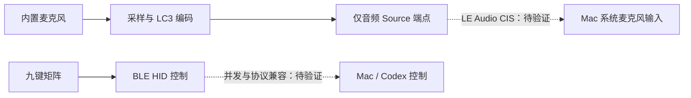

# 待验证方案：LE Audio 麦克风与 BLE 九键控制

调研日期：2026-10-23。状态：**方案研究，尚未实现或实机验证**。本页是多个硬件候选方案之一，不锁定主控，也不取代 [void9 / Pro Micro 与 ESP32 控制协议方案](void9-pro-micro.md)。

## 1. 目标与结论

整机目标是内置麦克风和电池，支持 USB 有线与蓝牙无线。无线模式优先探索：键盘直接连接 Mac，声音设置中只有麦克风输入，没有该设备的播放输出，同时可使用九键控制。不以额外接收器或配套虚拟音频软件作为这一原生直连方案的前提。

| 层次 | 本次结论 | 证据与边界 |
| --- | --- | --- |
| 单向音频 | 有协议与开源实现依据 | BAP 区分 Source / Sink 端点，Zephyr 允许分别配置其数量；不等于 Mac 接受所有组合 [S1][S2] |
| Mac 系统麦克风 | 未证实，是首要兼容性风险 | 尚未找到充分的官方支持说明或可复现的第三方 source-only 麦克风直连案例；不据此断言所有 Mac 都不支持 |
| LE Audio 与 BLE HID 并发 | 架构上可行的判断，待验证 | 音频通过 ISO、控制通过 GATT；这不是本项目已验证的组合固件 [S1] |
| 复用 voxu | 可评估复用麦克风和交互经验，不能直接复用现有蓝牙音频固件 | 现有 ESP32-WROOM-32 不支持 LE Audio [S4][S6] |

“支持蓝牙”“能配对”“具备 LC3”均不足以证明 Mac 已将设备注册为系统麦克风。通过原型验收前，不承诺 Mac 原生兼容或整机功耗、续航、延迟和音质。

## 2. 设备端实现路线

以键盘为 BAP Unicast Server，Mac 需要具有匹配的 Unicast Client 支持：

Source / Sink 以键盘设备为视角：Source 发送麦克风音频到 Mac，对应 Mac 的输入；Sink 接收 Mac 播放音频。本候选仅提供 Source，不提供音频 Sink。Zephyr 的 `bt_bap_unicast_server_register_param` 分别提供 `src_cnt` 与 `snk_cnt`，数量范围包含零，可作为一个 Source、零 Sink 的开发起点。[S1][S2]

需要支持 LC3、LE Isochronous Channels（本方案使用单播 CIS）、PACS / ASCS 等音频能力与流配置。端点数量设置只是其中一步；顶层角色、音频上下文、采样配置及主机发现流程仍需按协议栈和目标 Mac 验证。不能认为删掉 Sink 后，完整音频产品就已实现。[S1]

MICP / MICS 可用于麦克风静音控制，但不负责传输音频；广播音频 Auracast / BIS 也不能直接作为本方案的 Mac 系统输入替代。[S1]

键盘控制优先复用之前调研的 Codex Micro 厂商 BLE HID 协议；兼容失败时，再按 [快捷键降级边界](void9-pro-micro.md#5-快捷键降级只承诺实际可映射的能力) 逐项记录支持范围。普通 HID 输入成功，不代表 Agent 槽位、Fast、Fork、Mic 和状态回传全部可用；Mic 必须单独验证按下和释放。

## 3. Mac 兼容性风险

苹果的 Mac 助听设备文档介绍 MFi 助听器及声音处理器，并包括 Mac 向设备播放音频的流程。其设备范围和方向不能证明 Mac 接受任意通用 LE Audio 麦克风，更不能证明只有 Source 的组合一定成立。AirPods 的录音能力同样不能直接外推到自制设备。[S3]

尚未找到充分证据证明“自制 LE Audio 仅麦克风、Mac 原生直连、无需接收器或配套软件、同时 BLE HID”这一完整组合可复现。开源设备端协议栈已有基础，不代表存在可直接刷写并保证 Mac 兼容的成品固件。[S1][S2]

验证必须记录 Mac 型号、芯片、macOS 版本和构建号，以及开发板、控制器、协议栈版本、固件提交和配置。单台机器通过后，只声明该组合已验证；更新系统或更换主控后应复测。蓝牙版本号本身不能代替主机音频角色与端点验证。

排查时区分：设备未被发现、配对失败、未发现音频服务、CIS 未建立、没有系统输入、录音无声、仍出现输出端点、与 HID 并发失败。任一原型失败先定位所属层次，不能直接归结为所有 Mac 都不支持 LE Audio。

## 4. 主控与 voxu 复用要求

| 主控或平台 | 角色与限制 |
| --- | --- |
| Pro Micro / ATmega32U4 | 保留 USB 键盘候选价值；本身无蓝牙，不能独立承担本 LE Audio 路线 |
| voxu 当前 ESP32-WROOM-32 / ESP32-D0WD-V3 | 当前 HFP 原型的基础；原版 ESP32 不支持 LE Audio，不能仅升级应用固件实现 [S4][S6] |
| ESP32-S3 | 可另行评估 USB/BLE 控制，但官方对比表明确不支持 LE Audio；不能因其支持 BLE 就选择为本音频主控 [S4] |
| ESP32-S31 | 官方文档列为支持 CIS / BIS 的 LE Audio 候选；注意与 S3 区分。板卡可获得性、SDK 配置、source-only 与 HID 并发、Mac 互通均未在本项目验证 [S4] |
| 其他主控 | 可独立选型；应有明确的 LE ISO/CIS、LC3、BAP 设备端与 HID 支持，不能泛称“ESP32 系列均支持” |

选型还需核实麦克风输入接口与采样时钟、LC3 编码实时性、内存和射频调度资源，以及实体九键扫描能力。单芯片是否足够待验证；如采用双主控，需要另行设计通信、复位和功耗管理。

voxu 当前使用 INMP441 / I²S，已有音频与 Classic HID F13 在 Mac 上同时工作的记录；这可用于参考接线和交互验证方法，不是 LE Audio 或 Codex 厂商 BLE HID 已兼容的证据。参考提交还明确关闭 BLE、启用 BR/EDR-only，不能把这套配置与新的 BLE 音频栈直接拼接。[S6][S7]

USB 模式需要另行验证 USB Audio Class 的仅输入配置与键盘控制复合枚举；支持 LE Audio 不等于同时具备所需原生 USB 能力。电池路线还需充放电保护、充电与供电路径、USB 插拔切换、待机和录音功耗实测，当前没有据此确定电池容量或续航。

## 5. HFP 能否只注册成麦克风？

**应用上只使用麦克风，与系统只创建输入端点是两回事。** HFP 规范将 HF 定义为远端音频输入和输出机制，并规定音频连接建立后同步链路两个方向均有有效语音数据。它不是与 LE Audio Source / Sink 或 USB 音频通道描述符等价的单向端点配置机制。[S5：§2.2、§2.3]

| 做法 | 能否满足“Mac 原生只注册麦克风”？ |
| --- | --- |
| 不安装扬声器，只采集麦克风 | 不能据此保证；主机仍按公布的音频服务建立端点 |
| 固件收到下行后直接丢弃 | 不会因此撤销输出端点；voxu 当前实测就是输入与输出并存 [S6] |
| 把扬声器音量设为零，或关闭远程音量控制功能 | 控制音量或功能协商不等于移除音频输出方向；HFP HF 的 SDP SupportedFeatures 表没有“仅麦克风、无播放端点”的开关 [S5：§6.3、表 6.4] |
| 不提供 A2DP | 不能解决本例；A2DP 不是 HFP 自身输出端点出现的必要条件，voxu 当前 HFP/HID 配置仍显示输出 [S6][S7] |
| Mac 输入选键盘，输出选原来的扬声器 | 可规避把声音送到无扬声器设备，但输出列表仍存在该设备，不满足仅输入目标 |

因此，本项目不能把“只上传需要的麦克风内容、丢弃下行”描述为“修改 HFP 注册即可隐藏输出”。当前没有找到标准 HFP 外设侧配置能保证 macOS 仅注册输入的实现。主机定制驱动、过滤或虚拟音频属于另一路线，需要额外软件与独立验证，不是该原生直连方案已经可用。

voxu 2026-09-29 记录的是原项目特定 Mac 上的 HFP / Classic HID 原型结果；本键盘仓库未重新执行该实测，也未修改 voxu 固件。[S6]

## 6. 原型验收步骤

以下均为后续待执行步骤，未完成项不标记通过。次数和时长为本项目建议的首轮门槛，不是蓝牙规范指标，也不构成量产认证。

### A. 先验证纯音频直连

1. 选定开发板与可构建的 LE Audio 协议栈，保留构建命令、配置和固件提交；先不加入九键、电池与外壳。
2. 设置一个音频 Source、零音频 Sink，公布匹配的音频能力；关闭 HFP / A2DP 回退，避免把 Classic 音频成功误判为 LE Audio 成功。
3. 清除测试设备旧配对缓存后配对，记录服务发现、能力协商、CIS 建立和 LC3 配置日志。仅配对成功不算通过。
4. 检查“系统设置 → 声音”与“音频 MIDI 设置”：输入列表中可选键盘麦克风，输出列表无该键盘播放设备。用 CoreAudio 查询该设备的输入/输出流配置，确认**输入通道大于零、输出通道为零**；记录设备 UID，不能仅按显示名称判断。
5. 用录音应用录制、回放测试语音，确认是实体麦克风而非电脑内置麦克风。录音时使用 Mac 原有扬声器或耳机播放声音，确认默认输出没有切到键盘。

**通过条件：不使用接收器、虚拟音频软件或 HFP 回退，能够录音，且不存在键盘的播放端点。** 任一条件失败，当前组合不满足原生直连目标，先排查兼容性，不据此锁定最终 PCB。

### B. 再验证键盘与音频共存

1. 在相同固件上加入 BLE HID，先验证普通无副作用按键，再验证 Codex Micro 厂商 HID 的发现、查询应答与状态回传。
2. 保持 LE Audio 录音，连续操作九键至少 100 轮，检查丢键、重复触发、按键释放丢失和音频中断。Approve、Decline、Fork、Send 只在专用测试对话中验证。
3. 将目标应用的输入选择为键盘麦克风，验证 Mic 按下开始、释放结束，长按不重复触发；识别文本由用户检查，再测试 Send。不得用 F13 切换式听写冒充原版按住听写。
4. 录音与按键并发运行至少 30 分钟；记录音频丢帧/断流、按键异常和资源占用，确认输出端点没有因打开录音或重连而出现。
5. 执行至少 3 次设备冷启动、5 次断线重连及 5 次 Mac 休眠唤醒；确认自动恢复策略、无按键残留、无持续录音，并复查输入/输出通道。

普通 HID 通过但厂商协议失败时，单独记录为快捷键降级结果，按九键方案标明受限动作，不写成完整 Codex Micro 控制已通过。

### C. 音频与控制通过后，再验证双模和电池

1. 接入 USB，验证有线模式的麦克风仅输入和键盘控制，明确 USB/蓝牙同时存在时使用哪条音频与控制路径，避免重复按键和双路录音。
2. 测试 USB 插拔、充电与电池供电切换，确认不重启或丢失释放事件；验证低电量和关机时安全结束录音。
3. 测量待机、录音、按键并发和充电时电流，再确定电池容量、续航与待机策略；LE Audio 名称本身不是整机低功耗保证。

### 结果记录模板

| 项目 | 待填写证据 |
| --- | --- |
| 环境与版本 | Mac 型号 / 芯片 / macOS 与构建号；开发板 / 控制器 / SDK / 固件提交与配置 |
| 纯 LE Audio 证据 | 服务发现与 CIS / LC3 日志；无 HFP 回退、无接收器或虚拟软件 |
| 系统端点 | 输入/输出列表；CoreAudio UID 与输入/输出通道数 |
| 录音与应用 | 实体麦克风录音结果；目标应用与版本、输入选择、Mic 按下/释放行为 |
| 并发与恢复 | 100 轮操作、30 分钟录音、冷启动/重连/休眠各轮结果与失败日志 |
| 双模与电池 | USB 复合枚举、路径切换、供电切换和电流测量 |
| 判定 | 通过的具体组合、失败所属层次、未完成项和下一步 |

如原生直连无法满足要求，可分别评估 HFP（接受双端点）、USB 有线仅输入、无线接收器转 USB 仅输入或配套软件方案。它们的接入方式和依赖不同，不能记为本方案已通过；任何改选应保留实际限制。

## 7. 来源与范围

| 编号 | 来源 | 用途 |
| --- | --- | --- |
| S1 | [Zephyr LE Audio 架构](https://docs.zephyrproject.org/latest/services/connectivity/bluetooth/api/audio/bluetooth-le-audio-arch.html) | BAP / PACS / ASCS、GATT / ISO、LC3、MICP 与角色边界 |
| S2 | [Zephyr Unicast Server 注册参数](https://docs.zephyrproject.org/latest/doxygen/html/structbt__bap__unicast__server__register__param.html) | Source / Sink 分别计数且允许零；设备端开发起点 |
| S3 | [苹果：在 Mac 上使用助听设备](https://support.apple.com/guide/mac-help/use-hearing-devices-with-your-mac-mchle83953a5/mac) | 公开说明针对 MFi；不能外推通用仅麦克风 LE Audio 支持 |
| S4 | [乐鑫 Bluetooth Audio 芯片对比](https://docs.espressif.com/projects/esp-adf/en/latest/solution-center/bluetooth-audio.html) | ESP32 / ESP32-S3 / ESP32-S31 的 Classic、BLE、LE Audio 能力区别 |
| S5 | [Bluetooth SIG：HFP 1.10](https://www.bluetooth.com/specifications/specs/hands-free-profile-1-10/) / [规范正文](https://www.bluetooth.com/specifications/specs/html/?src=hfp_v1-10_1777579152%2FHFP_v1.10%2Fout%2Fen%2Findex-en.html) | §2.2 HF 输入/输出角色、§2.3 双向同步音频、§6.3 表 6.4 HF 功能位 |
| S6 | [voxu HFP 原型记录](https://github.com/krisxia0506/voxu/blob/6e55e777a23e1938179b623faf87bc70a563ee8c/firmware/hfp-probe/README.md) | INMP441、HFP 双端点、Classic HID / F13 与原项目实测边界 |
| S7 | [voxu 蓝牙配置](https://github.com/krisxia0506/voxu/blob/6e55e777a23e1938179b623faf87bc70a563ee8c/firmware/hfp-probe/sdkconfig.defaults) | 现有 BR/EDR-only、BLE 关闭、HFP / Classic HID 配置 |

官方与 latest 页面会变化，后续原型需固定 SDK 和固件版本并重新核对。本次仅整理方案，没有导入 voxu 或其他上游源码、图片、模型，没有构建、刷写、配对、录音、耗电测量或 Codex 按键操作；所有原型验收均待执行。
