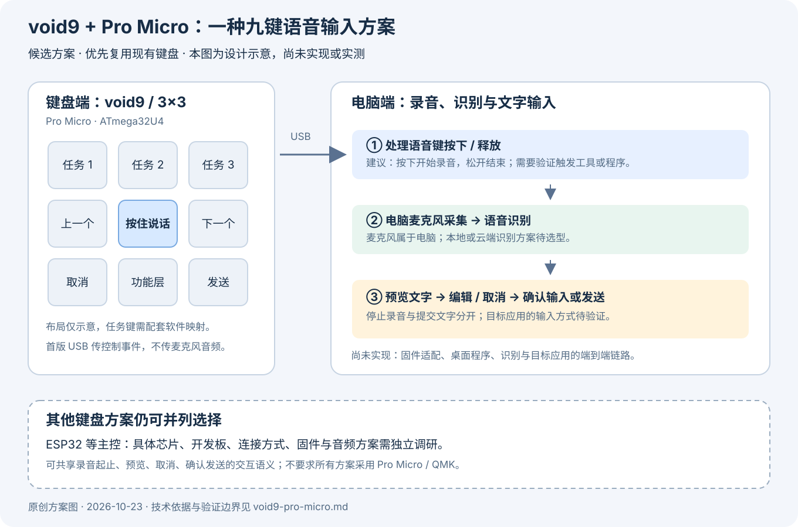

# 键盘候选方案：void9 + Pro Micro 与 ESP32 协议路线

更新日期：2026-10-23。项目保留多个硬件候选方案；本页以用户已有的 [void9](https://github.com/victorlucachi/void9) + Pro Micro（ATmega32U4）为起点，并列说明 ESP32 路线。

**优先评估兼容 Codex Micro 的厂商 HID 协议，快捷键作为降级方案。** 已找到同主控的开源固件及 ESP32 BLE 实现，但本项目尚未移植、编译、烧录或实机验证。上游作者的测试结果不等于本项目已验证。

## 1. 原版功能与九键布局

官方 Micro 有六个 Agent Keys、六种默认命令动作，以及旋钮和摇杆。九键方案保留全部六种命令动作，将 Agent Keys 缩减为三个；不包含原版完整控件数量。[S1]

| 左 | 中 | 右 |
| --- | --- | --- |
| Agent 1 | Agent 2 | Agent 3 |
| Fast | Approve | Decline |
| Fork | Mic | Send |

| 按键 | 原版默认行为 | 兼容协议中的逻辑键 ID |
| --- | --- | --- |
| Agent 1–3 | 选择对应的对话槽位；来源和绑定由桌面应用配置 | `AG00`、`AG01`、`AG02` |
| Fast | 切换 Fast mode | `ACT06` |
| Approve | 批准当前请求 | `ACT07` |
| Decline | 拒绝当前请求 | `ACT08` |
| Fork | 在新对话中继续当前对话 | `ACT09` |
| Mic | 按住说话，松开结束；使用电脑麦克风 | `ACT10` |
| Send | 发送输入框中的消息 | `ACT12` |

默认动作来自官方文档；逻辑键 ID 来自社区协议实现，不是普通键盘扫描码或官方稳定 API。[S1][S4][S5]

原版宽 Mic 键有两个机械开关，配置中可组合为一个动作。九键方案参考 Core2 的单键 Mic 实现，使用 `ACT10`，不需要占用两个键位。用户在桌面应用中重新映射后，实际动作可能不同于这些默认标签。[S1][S5]

## 2. 配图与语音链路

*图 1：原创方案图，展示待验证的布局和通信路线，不是实物照片或已实现功能。USB/BLE 在协议路线中传输控制与状态消息，麦克风音频由电脑端处理。*

本图只说明键盘控制协议原型。整机新增的目标是内置麦克风、电池和 USB/蓝牙双模；无线音频另见 [LE Audio 待验证方案](le-audio-microphone.md)。该方案不改变九键布局，也不表示 Pro Micro 或这里的 Core2 固件已经可以传输 LE Audio。

协议路线的目标链路为：

1. 按下、释放物理按键，固件发送对应的 Codex Micro 逻辑键事件。
2. 支持 Codex Micro 的官方桌面应用识别兼容设备，并执行配置的命令。
3. Mic 事件触发应用的按住听写，使用电脑麦克风，把识别文字放入输入框。
4. 用户检查、编辑文字，再按 Send；停止录音不等于提交消息。
5. 应用回传设备查询、灯光或任务槽位状态；没有灯光硬件时不承诺任务灯效果。

这条路线优先复用官方应用的听写与控件逻辑，不以自研语音识别服务为前提。语音听写与持续 Voice Chat 是不同功能，不能拿语音聊天快捷键当作原版 Mic 的等价实现。[S1][S7]

## 3. Pro Micro：USB 厂商 HID 协议移植

优先参考 MIT 许可的 [td2sk/codex-micro-fpad](https://github.com/td2sk/codex-micro-fpad)。该项目为 **ATmega32U4 Pro Micro** 实现 LUFA 固件，提供 Codex Micro 兼容厂商 HID，以及普通键盘/媒体键接口。上游说明已在 fpad 硬件测试。[S4]

已读取的源码包含 USB 描述符、分片重组、RPC 请求响应、按键通知和矩阵扫描。因此它提供同主控的移植起点，但不代表可以直接刷进 void9。

### 协议与移植范围

兼容实现使用厂商 HID usage page `0xFF00`、Report ID `6`，报文承载 JSON-RPC 风格消息；按键通知为 `v.oai.hid`，按下/释放使用 `act=1/0`。主机还会请求 `device.status`、`sys.version`，并发送 `v.oai.thstatus` 等状态。需要实现枚举、收发、分片和请求应答，不能只把普通键码改名。[S4]

移植时需要：

- 将 fpad 的 4×4 扫描改为 void9 的 3×3，配置九个物理键到上述逻辑键。
- 根据实物确认行列引脚、二极管方向、主控电压/时钟和 bootloader。
- 移除或隔离 fpad 专用的 I2C 扩展、灯光、编码器与摇杆逻辑；其接线不适用于现有 void9。
- 验证固件大小、RAM、USB 端点、请求应答、按键释放和断连恢复。
- 验证当前桌面应用的设备识别、三个 Agent 槽位与六个命令的实际行为。

**这是 LUFA 固件移植路线，不是现有 QMK/VIA 键图的直接配置。** 如果采用它，需要重新评估保留哪些现有配置功能；也可另行研究 QMK 移植，但不能假设普通 QMK Raw HID 自动等同于 Codex Micro 协议。

### 现有 void9 的接线约束

上游 void9 当前配置为列 `D1、D4、D0`、行 `F4、F5、F6`，二极管方向 `COL2ROW`；2022 年 10 月以前的构建使用列 `D1、D0、D4`。用户已确认主控，尚未确认实物接线、外壳和固件版本。[S2][S3]

用户已有的外壳与矩阵可作为复用基础，但不能直接使用 fpad 或其他键盘的预编译固件。

## 4. ESP32：BLE 厂商 HID 协议路线

并列参考 MIT 许可的 [imliubo/codex-micro-4-core2](https://github.com/imliubo/codex-micro-4-core2)。它在 ESP32/Core2 上实现 BLE 厂商 HID、按键事件、RPC 应答和状态接收，提供六个 Agent、六个命令、方向与旋钮动作的触屏界面。[S5]

上游报告于 2026-07-16 在实体 Core2、macOS 和支持 Micro 的桌面应用上验证；未记录具体桌面构建号，也未验证其 USB 控制路径。它没有采集或传输 Core2 自带麦克风音频，Mic 仍使用电脑麦克风。[S5]

用于本项目时，需要选择具体支持相应 BLE 实现的芯片/开发板，把触屏输入替换为物理九键，并适配按键扫描、供电、配对与状态反馈。Core2 的验证不能推广到整个 ESP32 系列，也不代表任意 ESP32 板都支持同样的 USB 或 BLE 路线。

Pro Micro/USB 与 ESP32/BLE 是两个候选实现，共享逻辑键及官方应用功能；不要求两者使用相同固件框架。两者都需重新验证当前桌面版本，不能直接把兼容实现视为官方授权或稳定接口。

## 5. 快捷键降级：只承诺实际可映射的能力

如果协议枚举或兼容性验证失败，可退回普通 USB/BLE 键盘快捷键。下面以官方 **macOS** 默认快捷键为依据；最终以目标机器的设置、前台窗口和当前界面状态为准。[S6]

| 原版功能 | 快捷键降级方式 | 与原生协议的差异 |
| --- | --- | --- |
| Agent 1–3 | `⌘⌥1–3` 打开最近对话 | 不能等同于所有置顶/优先/自定义槽位绑定，也没有任务灯回传 |
| Fast | 官方快捷键表未列对应默认键 | 需确认是否能在当前应用中配置；未确认前不宣称已支持 |
| Approve | 审批请求打开时 `Enter` | 受界面状态和焦点影响，不是任意位置都批准 |
| Decline | 审批请求打开时 `Esc` | 受界面状态影响；不等同于通用“取消录音” |
| Fork | 官方快捷键表未列对应默认键 | 不能用“新建空白对话”替代“在新对话继续” |
| Mic | 官方资料未建立一个可直接等价替代按住听写的默认快捷键 | 必须核对当前听写入口或已验证的配套工具；Voice Chat 快捷键不等价 |
| Send | 核对输入框焦点及当前发送设置后映射 | 不把全局 `Enter` 当作无条件发送 |

降级模式需要明确标示不支持的动作，不能在图上保留完整功能标签却暗示全部等价。平台快捷键不同，Windows/Linux 需要独立核对。

若 Mic 最终需要外部听写工具或自研桌面桥接，该依赖应作为降级方案单独实现和验证，不混入“官方原生 Mic 已支持”的结论。普通快捷键也无法直接恢复任务状态灯。

## 6. 实现顺序与后续验收

优先级建议：先验证 Pro Micro 的 USB 枚举、RPC 应答与一个无提交副作用的 Agent 选择事件，再验证六种命令；ESP32/BLE 独立验证；协议路线不满足要求时，再明确采用哪些快捷键降级。

- [ ] 编译适配当前 void9 的固件，核对资源和接线；保留现有配置与恢复方式。
- [ ] 当前官方桌面应用识别兼容设备，设备查询和应答正常。
- [ ] 三个 Agent 键选择预期槽位，桌面配置与实际动作一致。
- [ ] Fast、Approve、Decline、Fork、Mic、Send 分别验证；审批操作只在明确的测试请求中验证。
- [ ] Mic 按下开始、释放结束，长按不重复触发；检查文字后再由 Send 提交。
- [ ] USB 断连或 BLE 断开后状态恢复，不残留按键按下或持续录音。
- [ ] 任务状态回传与实际灯光硬件分别验收，不将无灯键盘标成具备任务灯。
- [ ] 快捷键模式逐项记录支持、受限与未支持动作。

本次交付仅为文档与配图。以上检查尚未在本项目硬件执行；没有编译或刷写固件，没有修改桌面应用，也没有执行审批或发送操作。

## 7. 来源、版本与许可

调研与文档更新日期为 2026-10-23。开源源码参考固定提交，官方页面的按键与快捷键信息可能随应用版本变化。

| 编号 | 来源 | 依据 |
| --- | --- | --- |
| S1 | [官方 Codex Micro 指南](https://learn.chatgpt.com/docs/features/codex-micro) | 默认六命令、Agent Keys、电脑麦克风与配置 |
| S2 | [void9 硬件资料](https://github.com/victorlucachi/void9/tree/1cf2aa31aa5fc601a2639c31b1ab5805a2a304f7) | 九键硬件、接线版本与许可 |
| S3 | [void9 QMK 配置](https://github.com/victorlucachi/qmk_firmware/blob/bb92edce13af21ba8bca42d9e30f4d8dae6e14a7/keyboards/handwired/void9/info.json) | 3×3 矩阵及引脚 |
| S4 | [fpad 固件](https://github.com/td2sk/codex-micro-fpad/tree/7b5a5cfb0294b94c7537081afc5bee727a9cf416) / [协议](https://github.com/td2sk/codex-micro-fpad/blob/7b5a5cfb0294b94c7537081afc5bee727a9cf416/docs/protocol-context.md) / [输入代码](https://github.com/td2sk/codex-micro-fpad/blob/7b5a5cfb0294b94c7537081afc5bee727a9cf416/src/input/input.c) | 同主控 LUFA/USB 实现、逻辑键与接线差异 |
| S5 | [Core2 固件](https://github.com/imliubo/codex-micro-4-core2/tree/2ee23a4ab696f94bb78d250f28cc4a9b879ba079) / [技术说明](https://github.com/imliubo/codex-micro-4-core2/blob/2ee23a4ab696f94bb78d250f28cc4a9b879ba079/docs/TECHNICAL.md) | ESP32 BLE 路线、验证范围与音频边界 |
| S6 | [官方快捷键表](https://learn.chatgpt.com/docs/reference/commands) | macOS 快捷键降级及使用条件 |
| S7 | [官方 Voice 说明](https://learn.chatgpt.com/docs/features/voice) / [语音听写](https://learn.chatgpt.com/docs/prompting#use-voice-dictation) | Voice Chat 与听写的区别 |

fpad/Core2 仓库使用 MIT 许可，依赖与其他第三方内容需分别保留其许可。void9 机械设计声明 CC BY-NC-SA 4.0，原 QMK/Vial 固件另有 GPL 声明；不能将未来引入的这些文件统一重新标为 MIT。

兼容实现依赖非官方、未稳定公开的设备协议，可能随桌面更新失效。社区实现使用的厂商标识不代表本项目取得相应 USB 标识分配权或官方背书。

本页与 [原创配图](assets/README.md) 沿用仓库 MIT 许可；本次没有导入上游固件、照片或机械模型。
