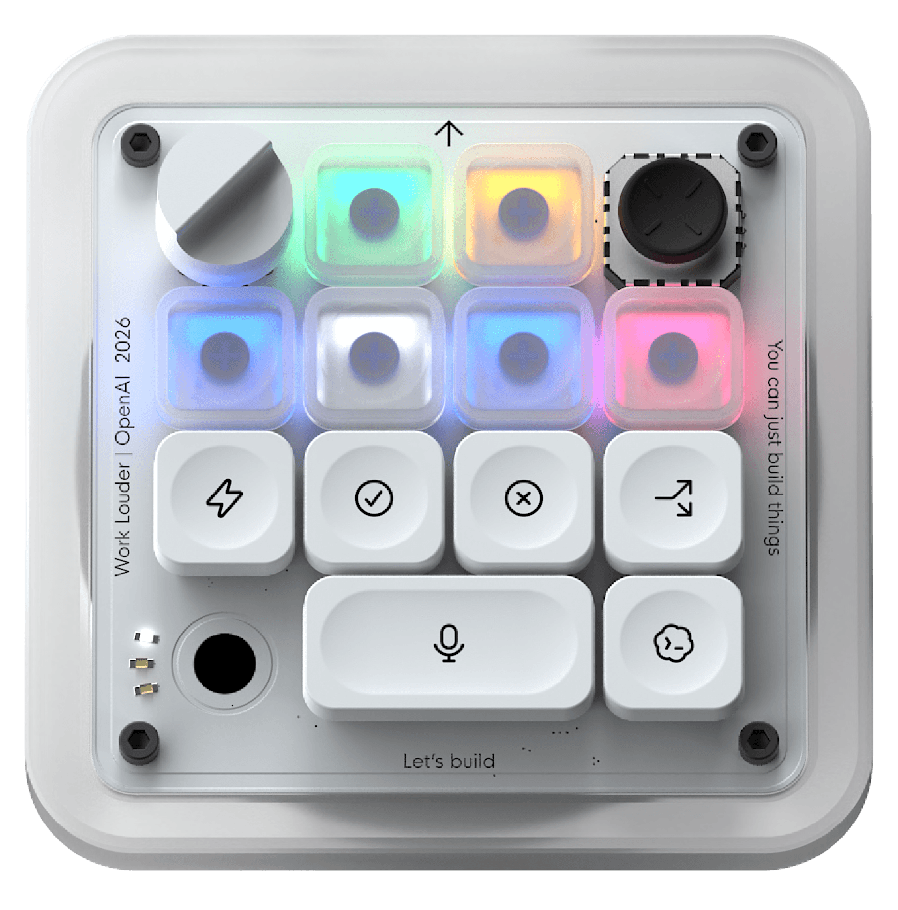
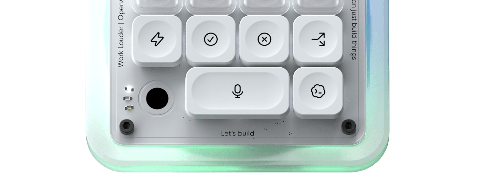

# Codex Micro 键盘产品调研

调研日期：2026-10-23。本项目希望做一款支持语音输入的开源 Codex Micro 风格键盘。

本文整理官方产品的外观、控件与语音输入体验，作为自研键盘的设计参考。原版使用电脑麦克风，键盘本身没有麦克风；本项目是否集成麦克风，以及采用何种语音识别方式，仍待原型验证。[S1]

官方产品能力与本项目计划应分开理解：本仓库当前只有调研文档，尚未提供可用的硬件、固件或桌面程序。

## 1. Codex Micro：把 Agent 工作台变成可触摸的桌面设备

### 1.1 外观与控件

*图 1：Work Louder 官方产品图。上半区是六枚半透明 Agent Keys，左上为旋钮、右上为摇杆；下半区是带图标的命令键。图中的麦克风图标代表控制功能，设备本身没有麦克风。[S1][S2]*

外观上，它像放在主键盘旁边的桌面控制面板：浅色机身、半透明键帽和 RGB 状态反馈，图标代替大段文字。产品页列出聚碳酸酯与铝材、机械开关、触控传感器、旋转编码器和平面摇杆，以及 USB-C / 蓝牙连接、Mac / Windows 兼容性。[S2]

读硬件数量时要区分「按键动作」和「机械开关」：文档说明六枚 Agent Keys、六种默认命令动作；规格列出 13 个机械开关，宽麦克风键下面的两个开关可以独立映射。因此不能简单把规格中的 13 当作 13 枚独立可见键帽。[S1][S2]

### 1.2 六个任务状态入口

六枚 Agent Keys 可以跟随最近更新的对话、置顶对话、优先任务，或自定义绑定。用户不必一直盯着屏幕，也能看到任务需要关注的时机。按键可切换对话，单击/双击的前台聚焦行为可配置。[S1]

| 灯光 | 含义 |
| --- | --- |
| 白色 | 空闲 |
| 蓝色 | 正在处理 |
| 绿色 | 已完成，存在未读更新 |
| 琥珀色 | 等待用户回复或批准 |
| 红色 | 错误 |
| 熄灭 | 未绑定对话 |

这套交互值得借鉴的是：**每个物理位置对应一个任务，灯光报告状态，按下就回到那个任务。** 它需要真实的任务状态数据支撑，不能只用固定宏模拟。[S1，产品分析]

### 1.3 命令键、语音、旋钮和摇杆

*图 2：Work Louder 官网展示的命令键，用图标表达常用动作；实际映射可以在桌面软件中调整。[S2]*

默认命令涵盖切换 Fast mode、批准、拒绝、在新对话中继续、按住说话和发送。旋钮可用于输入框导航、调整推理力度、滚动对话或自定义动作；摇杆可按四个方向映射命令或技能。原生集成可以在桌面应用内配置，Work Louder Input 则用于其他应用和更多层的快捷操作。[S1][S3]

**原版默认语音输入流程：**

1. 选择目标任务。
2. 按住语音键，对电脑麦克风说话，松开结束；也可双击进入免手持录音。
3. 灯光显示录音、识别处理、提示词准备完成的阶段。
4. 检查输入内容，再按发送键提交。

文档另有 Voice Chat 映射，但以设置中是否提供该选项为前提。需要区分「语音转成提示词」与「持续双向语音聊天」，不能看到麦克风键就推断默认支持后者。[S1]

### 1.4 对本项目的启发

- 保留少量高频控件：任务选择、说话、发送、确认、取消。
- 把「录音中」「任务执行中」「待确认」设计成不同反馈，避免用户不知道设备正在听还是正在做。
- 灯光反馈和可换图标提供低负担入口；复杂结果、代码差异和详细确认内容仍适合在电脑上显示。
- 控件重映射需要配套配置界面；只有相似外壳和按键宏，无法复现原版的任务联动体验。

本节为设计建议，尚未选定硬件或开发技术栈。

## 2. 本项目的设计目标

首版围绕「键盘控件 + 语音输入」展开：通过实体按键开始和结束录音，将识别出的文字输入电脑，并在发送前允许用户检查或取消。

| 方向 | 目标 | 当前状态 |
| --- | --- | --- |
| 键盘 | 紧凑布局、可配置快捷键，探索旋钮与 RGB 反馈 | 待设计 |
| 语音输入 | 按住说话、松开结束、识别结果可检查 | 待验证 |
| 音频采集 | 对比电脑麦克风与键盘集成麦克风的体验和成本 | 待选型 |
| 文字输入 | 验证在目标桌面应用中的输入、编辑和发送 | 待验证 |
| 桌面集成 | 评估 USB/BLE 厂商 HID 协议兼容，快捷键作为降级 | 已找到开源参考，本项目未移植或实测 |
| 开源交付 | 逐步提供硬件设计、物料清单、固件、配置和组装说明 | 尚未实现 |

本项目是独立社区项目。官方 Micro 的设备识别、任务灯同步与原生配置不代表自制键盘自动具备这些能力；具体支持范围将在原型验证后说明。

具体九键布局、Pro Micro 与 ESP32 协议路线及快捷键边界见 [键盘候选方案](../hardware/void9-pro-micro.md)。

建议首个验收闭环：连接键盘 → 按住语音键 → 说话 → 松开 → 检查识别文字 → 输入目标应用 → 手动发送或取消。

## 3. 来源与配图

以下官方资料于 2026-10-23 访问。本次保留已完成调研中的键盘相关内容，尚未开展硬件或语音输入实测。

| 编号 | 来源 | 用途 |
| --- | --- | --- |
| S1 | [OpenAI：Codex Micro 使用指南](https://learn.chatgpt.com/docs/features/codex-micro) | 任务灯、控件映射、电脑麦克风和语音输入 |
| S2 | [Work Louder：Codex Micro 产品页](https://worklouder.cc/codex-micro) | 外观、规格与官方配图 |
| S3 | [Work Louder：Codex Micro 设置指南](https://worklouder.cc/openai-micro-setup) | 硬件控制与扩展层 |

USB-C 在蓝牙模式下插入是否自动切换为有线，S1 与 S3 的描述存在差异，后续按实际固件验证，不据此制定本项目的连接策略。

图片来源见 [配图说明](assets/README.md)；第三方素材的权利说明见 [NOTICE](../../NOTICE)。
